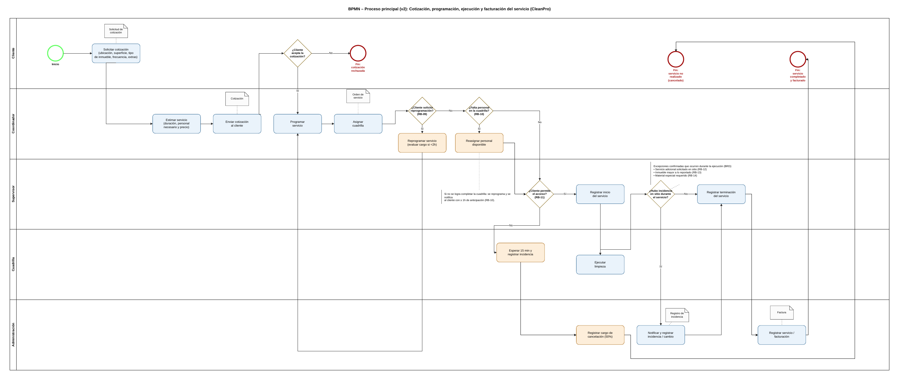

# BPMN — Proceso principal de CleanPro

Diagrama de la Unidad 2 (v2): cotización, programación, ejecución y facturación del servicio. El original está en [`originales-u2/BPMN_EQUIPO_12.pdf`](originales-u2/BPMN_EQUIPO_12.pdf).

## Carriles (swimlanes)

Cliente, Coordinador, Supervisor, Cuadrilla y Administración. En el sistema, cada carril corresponde a un rol (`Rol`) y cada endpoint valida qué rol puede ejecutar la tarea (RB-15). El cliente y la cuadrilla no operan cambios de estado en la API: el cliente responde la cotización y la cuadrilla consulta sus servicios.

## De las tareas del BPMN al sistema

| Elemento del BPMN | Carril | Regla | Operación del sistema |
|---|---|---|---|
| Solicitar cotización | Cliente | RB-01 | `POST /cotizaciones` |
| Estimar servicio (duración, personal y precio) | Coordinador | RB-03 | `POST /cotizaciones/{id}/estimacion` |
| Enviar cotización al cliente | Coordinador | RB-01, RB-08 | `POST /cotizaciones/{id}/envio` |
| ¿Cliente acepta la cotización? | Cliente | RB-02, RB-08 | `POST /cotizaciones/{id}/aceptacion` o `/rechazo` |
| Fin: cotización rechazada | Cliente | — | Estado `RECHAZADA` |
| Programar servicio + Asignar cuadrilla | Coordinador | RB-02, RB-04, RES-01 | `POST /servicios` |
| ¿Cliente solicita reprogramación? → Reprogramar servicio | Coordinador | RB-09 | `POST /servicios/{id}/reprogramacion` |
| ¿Falta personal? → Reasignar personal disponible | Coordinador | RB-10 | `POST /servicios/{id}/ausencia` |
| ¿Cliente permite el acceso? → Esperar 15 min y registrar incidencia | Supervisor | RB-11 | `POST /servicios/{id}/acceso-denegado` |
| Registrar cargo de cancelación (50 %) | Administración | RB-11 | Concepto `CANCELACION` en la factura |
| Registrar inicio del servicio | Supervisor | RB-05 | `POST /servicios/{id}/inicio` |
| Ejecutar limpieza | Cuadrilla | — | `GET /cuadrillas/{id}/servicios` (consulta) |
| ¿Hubo incidencia en sitio? (RB-12, RB-13, RB-14) | Supervisor | RB-06 | `POST /servicios/{id}/incidencias` |
| Notificar y registrar incidencia / cambio | Administración | RB-06 | Notificación a administración (`GET /notificaciones`) |
| Registrar terminación del servicio | Supervisor | RB-05, RES-03 | `POST /servicios/{id}/terminacion` |
| Registrar servicio / facturación | Administración | RB-07, RES-04 | `POST /facturas` |
| Fin: servicio no realizado / Fin: servicio completado y facturado | — | — | Estados `NO_REALIZADO` y `TERMINADO` + factura emitida |

## Gateways y máquina de estados

Cada gateway del BPMN es una transición protegida en la máquina de estados del dominio:

| Gateway | Rama | Transición en el sistema |
|---|---|---|
| ¿Cliente acepta la cotización? | Sí | `PENDIENTE → ACEPTADA` (si sigue vigente) |
| | No | `PENDIENTE → RECHAZADA` |
| | *(sin respuesta en 5 días hábiles)* | `PENDIENTE → VENCIDA` (US-22, agregado en el refinamiento) |
| ¿Cliente solicita reprogramación? | Sí | El servicio sigue `PROGRAMADO` con nueva fecha; cargo si es con menos de 2 h |
| ¿Falta personal en la cuadrilla? | Sí, se reasigna | El servicio sigue `PROGRAMADO` |
| | Sí, no se completa | Reprogramación con notificación al cliente |
| ¿Cliente permite el acceso? | Sí | `PROGRAMADO → EN_EJECUCION` |
| | No (15 min) | `PROGRAMADO → NO_REALIZADO` |
| ¿Hubo incidencia en sitio? | Sí | Incidencia en el servicio (sigue `EN_EJECUCION`) |
| | No | `EN_EJECUCION → TERMINADO` |

Los diagramas de estados completos están en [`../architecture/`](../architecture).
