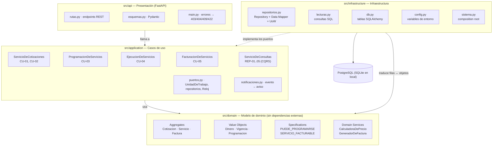
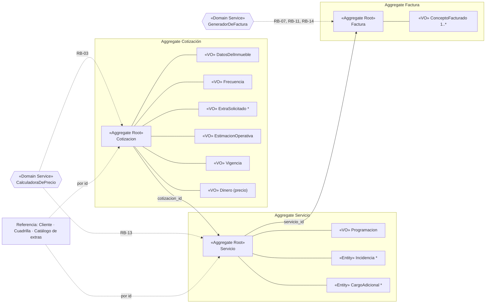
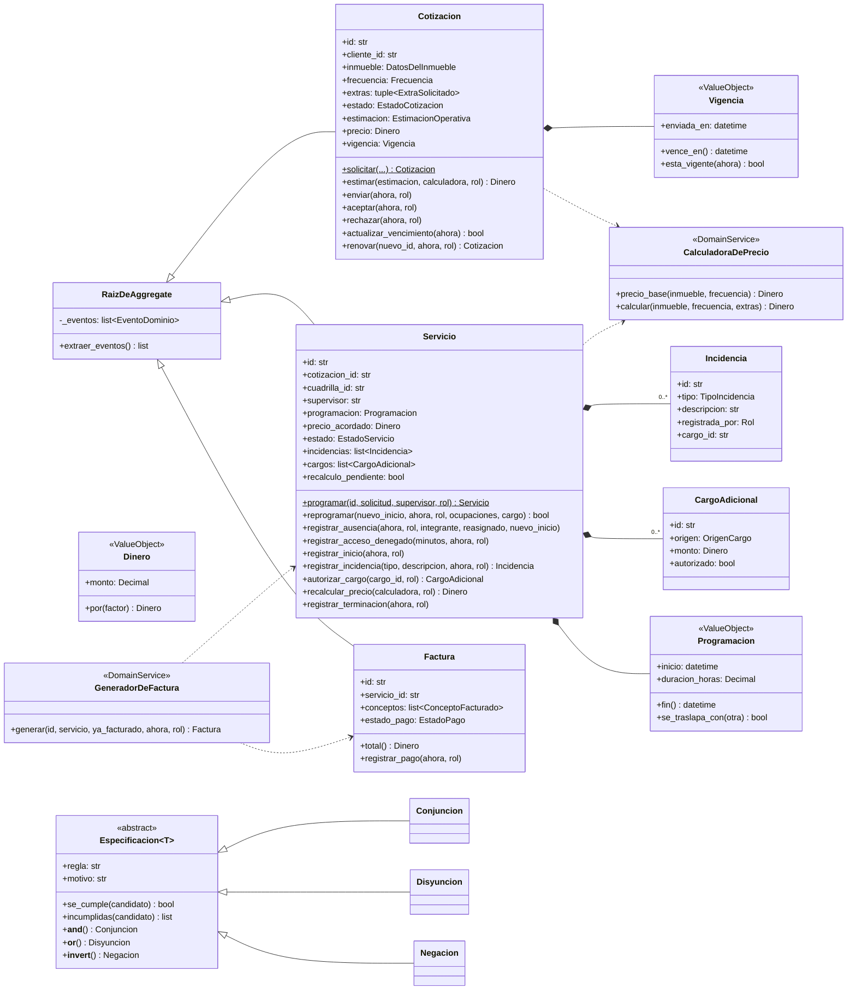
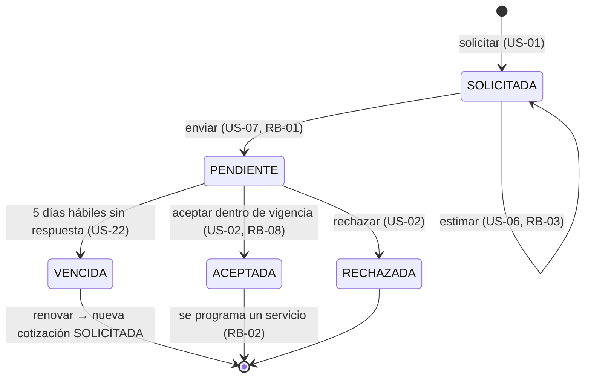
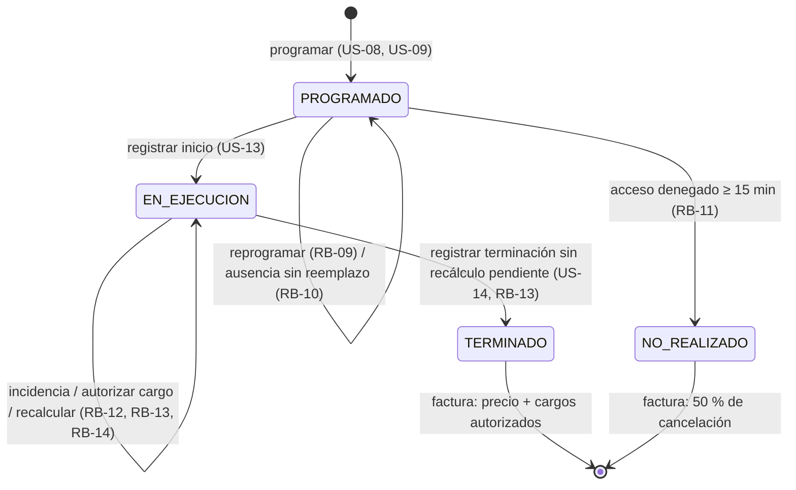
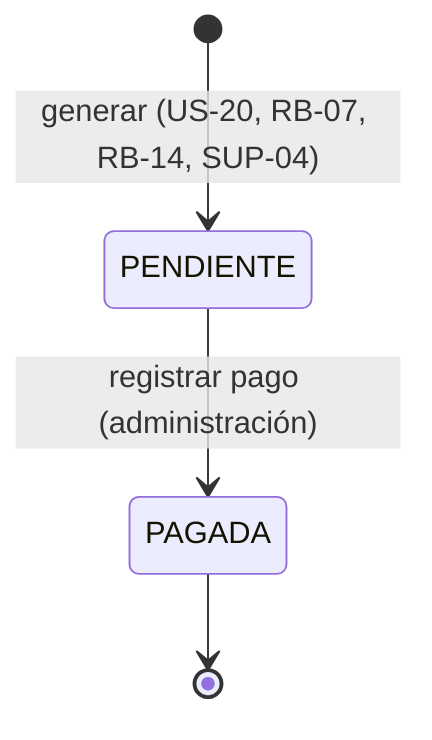
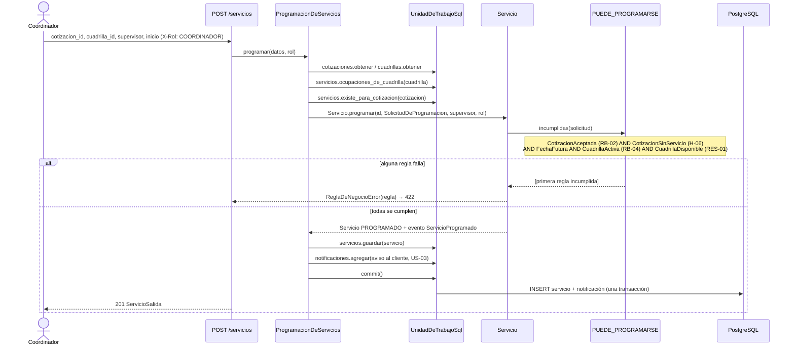
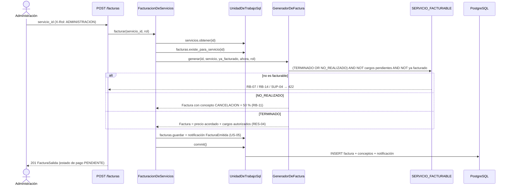
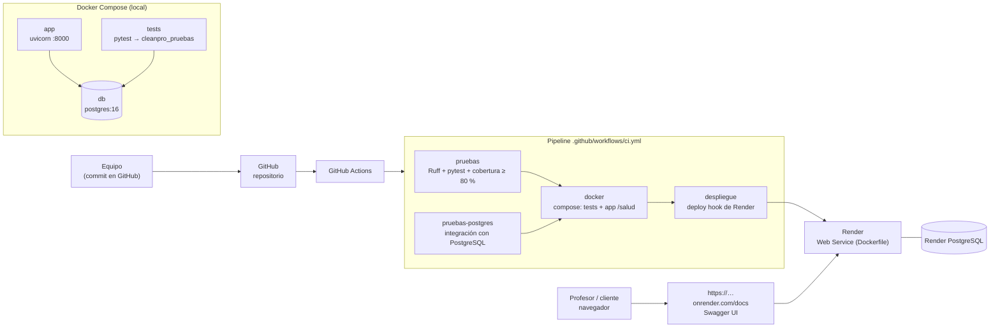

# Diagramas de arquitectura — CleanPro (PIA)

Los diagramas están en Mermaid: GitHub los dibuja directamente en esta página y el código queda versionado junto al software. Las imágenes PNG de cada uno están en [`img/`](img) para el reporte. Todos los nombres son los del código en `src/`.

Los diagramas de la Unidad 3 (draw.io, diseño en C#) se conservan en [`u3/`](u3) como antecedente. Las diferencias se explican en [decisiones-tecnicas.md](decisiones-tecnicas.md#6-cambios-respecto-a-la-unidad-3).

## 1. Arquitectura por capas

Las dependencias apuntan hacia el dominio. El dominio no importa nada de las otras capas (DIP).

## 2. Mapa de dominio (DDD)

| Evento de dominio | Lo produce | Aviso a | Regla |
|---|---|---|---|
| CotizacionEnviada | Cotizacion | Cliente | US-07 |
| CotizacionAceptada / Rechazada / Vencida | Cotizacion | Coordinador | US-02, US-22 |
| ServicioProgramado / ServicioReprogramado | Servicio | Cliente (y administración al reprogramar) | US-03, US-04, US-10 |
| IncidenciaRegistrada | Servicio | Administración (y coordinador si trae cargo) | RB-06, US-19 |
| CargoAdicionalAutorizado, PrecioRecalculado | Servicio | Administración | RB-12, RB-13, RB-14 |
| ServicioNoRealizado, ServicioTerminado | Servicio | Administración | RB-11, US-14 |
| FacturaEmitida | Factura | Cliente | US-05 |

## 3. Diagrama de clases (UML)

## 4. Máquinas de estados

### Cotización (H-03)

### Servicio (H-02)

### Factura (H-14)

## 5. Secuencia CU-03: programar servicio y asignar cuadrilla

## 6. Secuencia CU-05: facturar servicio

## 7. Despliegue y CI/CD

